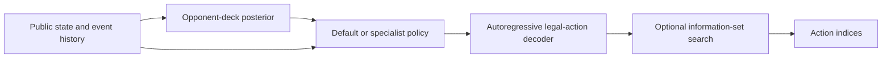

# Pokémon TCG: learned policies with opponent-aware search

A CPU inference release of a Pokémon Trading Card Game agent by Enci Zhang. The agent combines two Transformer/GRU policies, Bayesian opponent-deck inference, and simulation over plausible hidden states. Both trained checkpoints are included.

## Run the neural demo

The replay demo runs without the competition platform or native game engine.

```bash
python -m venv .venv
source .venv/bin/activate
python -m pip install -r requirements.txt
python scripts/replay_demo.py
```

It prints each policy's chosen option indices, action log probability, and value prediction. Indices refer to the current observation's legal choices. The value head produces a model estimate, not a calibrated probability of winning.

```bash
# Process the full example sequence and save predictions.
python scripts/replay_demo.py --limit 0 --output ../pokemon-runs/predictions.json
```

The example contains 58 consecutive decisions from one player's perspective, with native serialized state removed. The demo maintains each policy's history and compares their predictions on the same recorded states. It does not apply these choices to the game or enable routing and search.

## How the agent decides



Each policy has **6,531,939 parameters**, a six-layer state Transformer, a GRU history encoder, and a two-layer option Transformer. Model width is 192 with six attention heads. The autoregressive decoder selects from a variable list of legal actions and handles selections containing multiple indices.

The opponent classifier updates a posterior over **160 exact-deck hypotheses** using publicly observed cards. It routes to a specialist for a configured family of eight target decks; separate activation and deactivation thresholds reduce route switching. Both policies maintain their histories.

When its trigger conditions are met, search compares candidate actions across sampled hidden states using the native game engine. The submitted configuration uses two hidden-state samples, a six-second cooperative search deadline, at most four searches, and at most one override per game. It changes the base action when its completeness and risk criteria are satisfied. These limits apply to the search stage.

## Run a complete local game

Full games and simulation search require a compatible CABT engine. The tested Linux x86-64 library is retained locally and excluded from Git. Place a compatible library obtained from the competition at `engine_bridge/battle_runtime_bridge.so`. Its tested SHA-256 is in `provenance.json`. The [official engine documentation](https://matsuoinstitute.github.io/cabt/) describes the game and search interfaces.

On Linux or Ubuntu under WSL, from the repository root:

```bash
mkdir -p ../pokemon-runs
timeout --kill-after=10s 210s python scripts/run_match.py \
  --package "$PWD" \
  --output ../pokemon-runs/match.json \
  --baseline-mode random --seat 0 --seed 42 \
  --wall-seconds 180 --max-decisions 3000
```

Use a new output path for each run. `--seat 1` changes the agent's player seat. `--baseline-mode policy` uses the default neural policy as the opponent, with separate history and the submitted rule profile, without opponent routing or search. Both players use `deck.csv` unless `--baseline-deck path.csv` is supplied.

The runner checks legal indices and selection counts, records the terminal engine observation, and reports routing and search diagnostics. The external `timeout` bounds execution if a native call does not return.

## Local validation

Validation on October 7, 2026 used Python 3.12.3, PyTorch 2.14.1+cu132, and NumPy 2.5.2 under Ubuntu/WSL. All inference ran on **CPU**; no training was performed.

| Opponent | Games | Wins | Losses | Draws |
|---|---:|---:|---:|---:|
| Random legal selections | 8 | 8 | 0 | 0 |
| Default neural policy without routing or search | 2 | 1 | 1 | 0 |

The ten checks cover both player seats, the submitted deck, and a preselected target opponent deck. All 639 agent decisions were accepted. The specialist handled 73 decisions. Search was attempted six times and made zero overrides. This small suite checks execution and branch coverage; it does not establish competition performance or a search advantage.

Baseline seeds were 42 and 43 for random play and 44 for the neural baseline. Native engine randomness was uncontrolled because its optional random-device shim was absent. Swapping seats therefore does not produce identical shuffles. Submitted search settings and checkpoints were unchanged.

Results are in [`results/matches.csv`](results/matches.csv) and [`results/validation-summary.json`](results/validation-summary.json). Independent neural replay checks found identical actions, log probabilities, and values before and after source cleanup on 122 observations for each policy: [`results/release-equivalence.json`](results/release-equivalence.json).

Two additional games verified the curated package itself. Both reached valid terminal states; one exercised the specialist route and a search override. These separate execution checks are recorded in [`results/packaged-match-checks.json`](results/packaged-match-checks.json).

```bash
python -m unittest discover -s tests -p 'test_*.py'
```

## Code guide

| Path | Purpose |
|---|---|
| `main.py` | Submitted routing and search configuration |
| `policy_bridge/action_predictors/shared_decision_policy.py` | Neural architecture and decoder |
| `policy_bridge/battlefield_environment/` | State features, history, action constraints |
| `policy_bridge/decision_inference_bridge.py` | Checkpoint loading and inference |
| `policy_bridge/decision_search/` | Opponent classification and simulation search |
| `engine_bridge/` | Native engine interfaces |
| `scripts/replay_demo.py` | Engine-free demonstration of both policies |
| `scripts/run_match.py` | Local games against baseline agents |
| `provenance.json` | Source selection, cleanup rules, and hashes |

## Version record

This release derives from the author's archive and includes its runtime import closure and both original checkpoints. The archive labels this build `EXPORTED_UNPROMOTED`; local results above belong to this exact artifact. A competition ranking is not assigned to it here.

Preparation removes generated no-op exception wrappers and layout markers and normalizes formatting. Executable branches and model assets are preserved. Unreferenced experiment scripts remain in the original archive. This is an inference release; reproducing the original training run requires its separate data, configurations, and logs.
